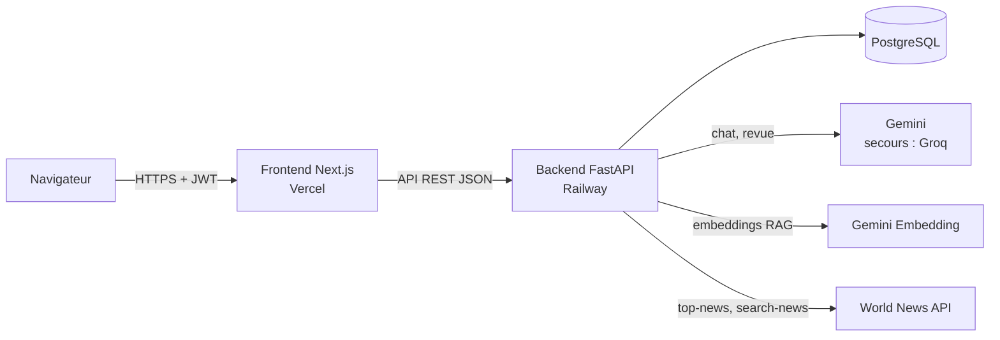
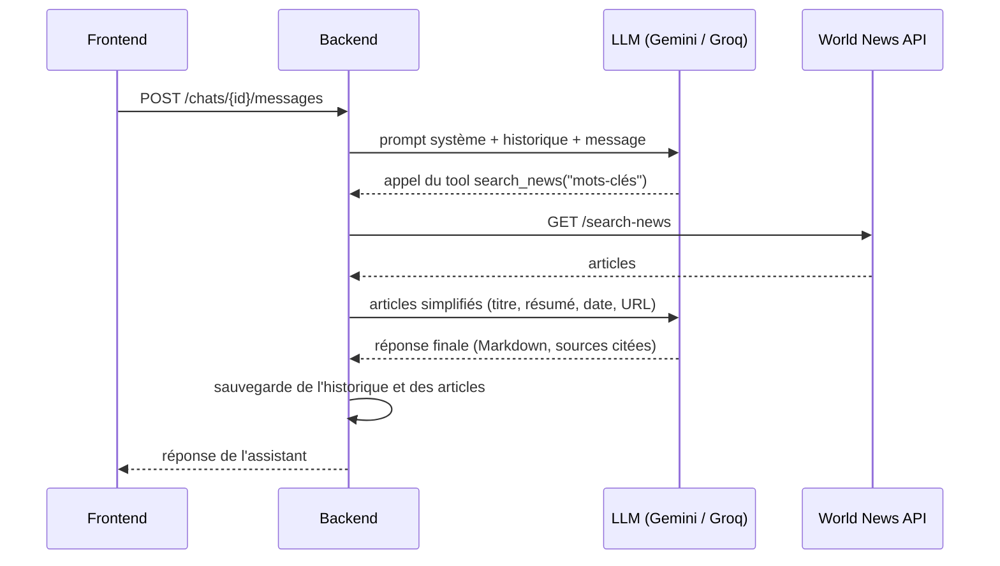

# NewsFoundry — Documentation technique

> **Projet 14 OpenClassrooms — Option B** : outil de revue de presse automatique par IA.
> Auteur : Wajih Djedidi — Octobre 2026

| | |
|---|---|
| **Application déployée (frontend)** | https://wd-newsfoundry.vercel.app |
| **Backend** | à déployer sur Railway (inscriptions Railway suspendues depuis le 21/10/2026, voir [§ 8](#8-déploiement)) |
| **Dépôt** | https://github.com/Wdj39/WD.Newsfoundry |
| **Compte de démonstration** | `test@test.com` / `test` |

## Sommaire

1. [Présentation](#1-présentation)
2. [Architecture et structure du projet](#2-architecture-et-structure-du-projet)
3. [Installation et lancement en local](#3-installation-et-lancement-en-local)
4. [Choix techniques et justifications](#4-choix-techniques-et-justifications)
5. [Fonctionnement de la partie IA](#5-fonctionnement-de-la-partie-ia)
6. [Choix des prompts](#6-choix-des-prompts)
7. [API backend : routes et erreurs](#7-api-backend--routes-et-erreurs)
8. [Déploiement](#8-déploiement)
9. [Tests et intégration continue](#9-tests-et-intégration-continue)
10. [Problèmes rencontrés et corrections](#10-problèmes-rencontrés-et-corrections)
11. [Pistes d'amélioration](#11-pistes-damélioration)

---

## 1. Présentation

NewsFoundry aide les journalistes pigistes à suivre l'actualité et à produire des revues de presse :

1. **Actualités du jour** : chaque nouvelle discussion démarre avec les gros titres du jour, récupérés via [World News API](https://worldnewsapi.com).
2. **Chat avec un agent** : l'utilisateur affine son sujet ; l'agent peut lancer lui-même des recherches d'articles supplémentaires (*tool* `search_news`).
3. **Revue de presse** : à partir d'une discussion, l'utilisateur génère une revue de presse structurée (titre, synthèse, articles résumés avec leurs sources), enregistrée en base. Un **RAG** (LlamaIndex) sélectionne les passages des articles les plus pertinents pour le thème demandé.

Fonctionnalités couvertes : connexion (JWT), liste des discussions, création / reprise d'une discussion, autorisation stricte (un utilisateur n'accède qu'à ses discussions), réponses du LLM, génération et consultation des revues de presse, messages d'erreur affichés à l'utilisateur.

---

## 2. Architecture et structure du projet

### Vue d'ensemble



Le projet est un **monorepo** : deux applications indépendantes dans un même dépôt, déployées séparément.

### Arborescence

```text
.
├── .github/workflows/tests.yml   # CI : tests backend + lint/build frontend
├── docs/DOCUMENTATION.md         # ce document
├── backend/                      # API Python (FastAPI)
│   ├── Dockerfile                # image de production (Railway)
│   ├── pyproject.toml / uv.lock  # dépendances (gérées avec uv)
│   ├── .env.example              # variables d'environnement à définir
│   ├── src/
│   │   ├── main.py               # application FastAPI : CORS, routes, mesure des durées
│   │   ├── config.py             # lecture centralisée des variables d'environnement
│   │   ├── database.py           # connexion, création des tables, mini-migration
│   │   ├── models.py             # tables SQLModel : User, Chat
│   │   ├── schemas.py            # formats des requêtes et réponses de l'API
│   │   ├── security.py           # hachage bcrypt, création/vérification des JWT
│   │   ├── dependencies.py       # dépendances FastAPI : utilisateur courant, LLM, clients
│   │   ├── routers/              # routes HTTP (une par domaine)
│   │   │   ├── auth.py           #   POST /login, GET /me
│   │   │   ├── chats.py          #   /chats, /chats/{id}, /chats/{id}/messages
│   │   │   └── reviews.py        #   /chats/{id}/review, /reviews
│   │   ├── services/             # logique métier (indépendante de HTTP)
│   │   │   ├── chat_service.py   #   autorisations, historique, appel de l'agent
│   │   │   ├── review_service.py #   génération des revues de presse
│   │   │   ├── news_api.py       #   client World News API + cache
│   │   │   ├── rag.py            #   RAG LlamaIndex (indexation, recherche)
│   │   │   └── llm_errors.py     #   conversion des erreurs LLM en erreurs HTTP
│   │   └── agents/               # partie IA (PydanticAI)
│   │       ├── llm.py            #   modèle Gemini + secours Groq (FallbackModel)
│   │       ├── chat_agent.py     #   agent du chat + tool search_news
│   │       ├── review_agent.py   #   agent de revue de presse (sortie structurée)
│   │       └── prompts.py        #   prompts système (voir § 6)
│   └── tests/                    # tests pytest (46 tests)
└── frontend/                     # application Next.js (TypeScript, Tailwind)
    └── src/
        ├── app/                  # pages (App Router)
        │   ├── login/page.tsx    #   connexion
        │   ├── (app)/layout.tsx  #   écrans connectés : garde d'authentification + sidebar
        │   ├── (app)/chat/[[...chatId]]/page.tsx  # /chat (nouvelle) et /chat/{id}
        │   └── (app)/reviews/page.tsx             # liste des revues de presse
        ├── components/           # composants d'interface (chat/, reviews/, Sidebar…)
        └── lib/                  # appels API, gestion du token, formatage des dates
```

### Organisation du backend en couches

| Couche | Rôle | Exemple |
|---|---|---|
| `routers/` | Reçoit la requête HTTP, valide les entrées, appelle un service | `routers/chats.py` |
| `services/` | Logique métier, réutilisable et testable sans HTTP | `services/chat_service.py` |
| `agents/` | Tout ce qui concerne les LLM : agents, tools, prompts | `agents/chat_agent.py` |
| `models.py` / `schemas.py` | Données stockées en base / données échangées avec le frontend | `Chat`, `ReviewView` |

Les dépendances externes (base de données, LLM, World News API, modèle d'embedding) sont injectées par des **dépendances FastAPI** (`dependencies.py`). Les tests les remplacent par des versions simulées, sans aucun appel réseau.

### Modèle de données

| Table | Champs principaux |
|---|---|
| `user` | `id`, `email` (unique), `hashed_password` (bcrypt) |
| `chat` | `id`, `user_id` (propriétaire), `created_at`, `updated_at`, `system_prompt`, `messages` (JSON), `loaded_articles` (JSON), `review_topic`, `review_title`, `review_summary`, `review_articles` (JSON), `review_generated_at` |

- `messages` : historique complet au format PydanticAI (messages, appels d'outils et leurs résultats), renvoyé tel quel au LLM à chaque message.
- `system_prompt` : prompt figé à la création de la discussion (avec les actualités du jour), pour que la discussion garde son contexte d'un jour à l'autre.
- `loaded_articles` : contenu complet des articles chargés pendant la discussion, source du RAG.
- `review_*` : dernière revue de presse générée à partir de la discussion (une nouvelle génération remplace la précédente).

---

## 3. Installation et lancement en local

**Prérequis** : Docker, Python 3.13, [uv](https://docs.astral.sh/uv/), Node.js 22.

### Backend

```bash
cd backend
cp .env.example .env          # puis renseigner les clés (voir tableau ci-dessous)
uv sync                       # installe les dépendances
docker run --name newsfoundry_db -e POSTGRES_USER=user -e POSTGRES_PASSWORD=password \
  -e POSTGRES_DB=newsfoundry -p 5432:5432 -d postgres:17
uv run --env-file .env src/main.py   # API sur http://localhost:8000
```

Au démarrage, les tables et l'utilisateur de test (`test@test.com` / `test`) sont créés automatiquement. La documentation interactive de l'API est disponible sur http://localhost:8000/docs.

### Frontend

```bash
cd frontend
npm install
npm run dev                   # application sur http://localhost:3000
```

### Variables d'environnement du backend

| Variable | Obligatoire | Rôle |
|---|---|---|
| `DATABASE_URL` | oui | Connexion PostgreSQL |
| `JWT_SECRET` | oui | Clé de signature des tokens (≥ 32 caractères aléatoires) |
| `CORS_ORIGINS` | non | Origines autorisées à appeler l'API (défaut : `http://localhost:3000`) |
| `GEMINI_API_KEY` | oui* | LLM principal et embeddings du RAG |
| `GROQ_API_KEY` | non* | LLM de secours |
| `WORLD_NEWS_API_KEY` | oui | Actualités |
| `GEMINI_MODEL`, `GROQ_MODEL`, `EMBEDDING_MODEL` | non | Noms des modèles (défauts : `gemini-3.8-flash`, `openai/gpt-oss-120b`, `gemini-embedding-001`) |
| `NEWS_*`, `RAG_*` | non | Réglages (pays, langue, nombre d'articles, cache, taille des extraits…) |

\* Au moins une clé de LLM est nécessaire.

Côté frontend, `NEXT_PUBLIC_API_URL` indique l'URL du backend (défaut : `http://localhost:8000`).

---

## 4. Choix techniques et justifications

### Stack imposée par le CTO

| Choix | Justification |
|---|---|
| **Python + FastAPI** | Écosystème IA de Python (PydanticAI, LlamaIndex) ; FastAPI valide automatiquement les entrées avec Pydantic, génère la documentation `/docs` et gère nativement l'asynchrone, utile pour les appels lents aux LLM. |
| **SQLModel + PostgreSQL** | SQLModel combine SQLAlchemy et Pydantic : un même modèle sert à la base et à la validation. PostgreSQL gère nativement les colonnes JSON utilisées pour l'historique. |
| **JWT** | Authentification sans état côté serveur : le token signé contient l'identifiant de l'utilisateur et sa date d'expiration (24 h). |
| **PydanticAI** | Client LLM pensé pour les agents : tools, sorties structurées validées, historique sérialisable, modèles de test pour les tests automatisés. |
| **Next.js** | Framework React de référence, déploiement natif sur Vercel. |
| **Vercel / Railway** | Déploiement continu depuis GitHub à chaque commit sur `main`. |

### Choix faits pendant le développement

| Choix | Alternatives écartées | Justification |
|---|---|---|
| **Gemini en LLM principal, Groq en secours** (`FallbackModel`) | Un seul fournisseur | Offres gratuites suffisantes ; si Gemini échoue (quota, surcharge), la requête est rejouée automatiquement sur Groq. Observé en conditions réelles : une erreur 503 de Gemini a été absorbée par Groq sans que l'utilisateur ne s'en aperçoive. |
| **Noms de modèles configurables** par variables d'environnement | Noms codés en dur | Les fournisseurs retirent leurs anciens modèles (`gemini-2.5-flash` et `llama-3.3-70b-versatile` ont été refusés pendant le développement) : on change de modèle sans modifier le code. |
| **Modèle injecté par dépendance FastAPI** (`get_chat_model`) | Modèle fixé dans l'agent | Les tests remplacent le vrai LLM par le `TestModel` / `FunctionModel` de PydanticAI : tests rapides, gratuits et déterministes. |
| **Historique PydanticAI complet en JSON** dans `Chat.messages` | Table de messages | Format natif de PydanticAI (`ModelMessagesTypeAdapter`) : l'historique, appels d'outils compris, est rejoué tel quel au LLM. Les appels d'outils sont masqués à l'affichage. |
| **Deux agents spécialisés** (chat / revue) | Un seul agent généraliste | Recommandation du sujet : l'agent de revue n'a pas d'outil et une seule tâche, avec des consignes de rédacteur en chef. |
| **Sortie structurée** (`output_type=PressReview`) | Texte libre à découper | PydanticAI transmet le schéma au LLM, valide la réponse et redemande en cas d'erreur (2 essais) : données directement enregistrables en base. |
| **Embeddings Gemini via API** pour le RAG | Modèle d'embedding local (HuggingFace) | Aucun modèle à charger en mémoire sur le serveur (offre gratuite de Railway limitée en RAM) ; même clé que le LLM. |
| **Index RAG en mémoire, non persisté** | Base vectorielle (pgvector, Chroma) | Quelques dizaines d'articles par discussion : recalcul rapide ; le sujet indique que la persistance n'est pas nécessaire. |
| **Cache des gros titres** (1 h, en mémoire) | Appel à chaque discussion | Le quota gratuit de World News API est d'environ 50 points par jour. |
| **404 pour la discussion d'un autre utilisateur** | 403 | Les identifiants sont des entiers successifs : un 403 révélerait qu'une discussion existe avec cet identifiant. |
| **Même message d'erreur au login** (email inconnu ou mot de passe faux) | Messages distincts | Ne révèle pas quels emails existent en base. |
| **Mini-migration** `add_missing_columns()` | Supprimer et recréer la base | `create_all` ne modifie pas une table existante ; ajoute les nouvelles colonnes sans perte de données. Alembic serait l'outil adapté à un projet plus grand. |
| **Tests sur SQLite en mémoire** | PostgreSQL en CI | Rapides et sans service externe ; la logique testée (autorisations, routes) est indépendante du moteur SQL. |
| **TypeScript + Tailwind CSS** | JavaScript, CSS modules | Typage des réponses de l'API ; reproduction rapide de la maquette Figma (palette et police IBM Plex Sans déclarées comme variables du thème). |
| **Police auto-hébergée** (`@fontsource/ibm-plex-sans`) | `next/font/google` | Build indépendant de Google Fonts (le build échouait sans accès réseau). |
| **Token dans le `localStorage`** | Cookie `httpOnly` | Demandé par le sujet. Limite connue : un script injecté (XSS) pourrait le lire ; le cookie `httpOnly` serait plus sûr. |

### Accessibilité et expérience utilisateur

- Champs de formulaire associés à leurs libellés, messages d'erreur annoncés aux lecteurs d'écran (`role="alert"`), loaders signalés (`aria-busy`, `role="status"`), navigation au clavier (Entrée pour envoyer, Échap pour fermer la fenêtre de génération).
- Loaders sur toutes les actions lentes : connexion, chargement des discussions, réponse de l'agent (« L'assistant rédige sa réponse… »), génération de la revue (« Génération en cours… »).
- Affichage immédiat du message envoyé ; en cas d'échec, il est retiré et remis dans le champ de saisie pour réessayer.
- Écart assumé avec la maquette : un champ « Mot de passe » a été ajouté à l'écran de connexion (la maquette n'a qu'un champ email, mais la route `/login` exige un mot de passe).

---

## 5. Fonctionnement de la partie IA

### Création d'une discussion (étape 5 du sujet)

1. `POST /chats` appelle `/top-news` de World News API (sources françaises, en français), servi par le cache s'il a moins d'une heure.
2. Un seul article est retenu par sujet (l'API regroupe les articles traitant du même sujet), 15 sujets au maximum, réduits à leur titre, un résumé de 300 caractères maximum, la date et l'URL.
3. Ces actualités sont insérées dans le prompt système, **sauvegardé avec la discussion**. Le contenu complet des articles est conservé dans `loaded_articles` pour le RAG.
4. Si World News API est indisponible, la discussion est créée quand même et le prompt indique au modèle qu'il n'a pas l'actualité du jour.

### Message dans le chat (étapes 4 et 6)



Le **tool `search_news`** :
- est décrit au modèle par sa docstring : quand l'utiliser (approfondir un sujet) et comment (2 à 5 mots-clés) ;
- renvoie un format simplifié (4 champs) plutôt que la réponse brute de l'API, volumineuse ;
- est limité à **3 recherches par message** et 5 articles par recherche (quota), avec au plus 8 allers-retours avec le LLM par message ;
- renvoie les erreurs de l'API **au modèle** (qui prévient l'utilisateur) au lieu de faire échouer la réponse.

### Génération de la revue de presse (étapes 7 et 8)

1. L'utilisateur choisit un thème ; `POST /chats/{id}/review` est appelé.
2. **RAG** (`services/rag.py`) : le contenu des articles chargés est découpé en extraits de 512 tokens (LlamaIndex `SentenceSplitter`), converti en embeddings (Gemini), et les **12 extraits les plus proches du thème** sont retrouvés puis regroupés par article.
3. L'**agent de revue** reçoit le thème, la transcription de la discussion et ces extraits, et renvoie une sortie structurée : `title`, `summary` (Markdown) et `articles` (titre, média, URL, résumé).
4. La revue est enregistrée dans le `Chat` et affichée sur la page « Revues de presse » (bouton « Copier » au format Markdown).

**Repli sans RAG** : si aucun article n'a été chargé, si aucun modèle d'embedding n'est configuré ou si le calcul échoue, l'agent reçoit la transcription complète avec les résumés des articles (fonctionnement de l'étape 7).

> Pourquoi une **transcription** plutôt que l'historique PydanticAI brut ? L'historique contient des appels au tool `search_news`, que l'agent de revue ne possède pas. La transcription garde tout le contexte utile dans un format lisible.

---

## 6. Choix des prompts

Les prompts sont regroupés dans `backend/src/agents/prompts.py`.

### Prompt système du chat

| Élément du prompt | Raison |
|---|---|
| **Rôle précis** : « assistant de NewsFoundry, outil qui aide les journalistes pigistes » | Cadre le ton, le niveau d'exigence et le public. |
| **Date du jour** | Le modèle ne connaît pas la date (date de fin d'entraînement) : nécessaire pour juger ce qui est « récent ». |
| **Section « Recherche d'articles »** : quand utiliser `search_news`, requêtes de 2 à 5 mots-clés, nouvel essai si aucun résultat | Oriente l'usage du tool, en complément de sa docstring. |
| **Règles de fiabilité** : s'appuyer sur les articles fournis, ne jamais inventer, dire « je ne sais pas » | Principal risque d'un outil d'actualité : l'hallucination. Vérifié en test réel : sans actualités, le modèle a refusé d'inventer un résumé de la semaine. |
| **Citer les sources en liens Markdown** | Les journalistes doivent pouvoir vérifier chaque information. |
| **Neutralité** sur les sujets politiques | Usage professionnel, sujets sensibles. |
| **Style** : français, concis, Markdown léger, question de relance | Adapté à l'affichage en bulles de chat (rendu Markdown par `react-markdown`). |
| **Actualités dans une balise `<actualites>`**, un article par ligne (titre, résumé, date, URL) | Sépare clairement les données des consignes ; format compact (seulement titre + résumé, comme demandé). |

Le prompt est passé via les **`instructions`** de PydanticAI (recalculées à chaque appel à partir du prompt enregistré pour la discussion), et non via un `system_prompt` envoyé une seule fois.

### Prompt de l'agent de revue de presse

| Élément | Raison |
|---|---|
| Rôle de **rédacteur en chef** | Style journalistique, synthèse plutôt que liste. |
| Ordre de priorité des **sources** (extraits RAG, sinon discussion) | Indique au modèle comment utiliser les extraits retrouvés. |
| « Ne retiens que les articles en rapport avec le thème » | Objectif du RAG : la revue ne doit citer que les articles pertinents. |
| « Recopie les URL à l'identique », « n'invente aucun article » | Évite les liens inventés. |
| Revue courte et signalée comme telle si les sources sont pauvres | Préférer une revue honnête à une revue complétée par des suppositions. |
| Discussion et extraits dans des balises `<discussion>` et `<extraits_articles>` | Séparation consigne / données. |
| **Descriptions des champs** du schéma de sortie (titre en majuscules, synthèse de 2 à 4 paragraphes, résumé de 2-3 phrases par article) | Le schéma Pydantic transmis au modèle sert aussi de consigne de format. |

---

## 7. API backend : routes et erreurs

Toutes les routes, sauf `/login` et `/`, exigent l'en-tête `Authorization: Bearer <token>`. Les erreurs sont renvoyées au format FastAPI `{"detail": "message"}` via `HTTPException`, avec un message en français affiché tel quel dans l'interface.

### Routes

| Méthode | Route | Description | Succès |
|---|---|---|---|
| `POST` | `/login` | Connexion (`{email, password}`) → `{access_token, token_type}` | 200 |
| `GET` | `/me` | Utilisateur connecté | 200 |
| `GET` | `/chats` | Discussions de l'utilisateur (plus récentes d'abord) | 200 |
| `POST` | `/chats` | Crée une discussion (avec les actualités du jour) → `{id, …}` | 201 |
| `GET` | `/chats/{id}` | Historique d'une discussion | 200 |
| `POST` | `/chats/{id}/messages` | Envoie un message (`{content}`) → réponse de l'assistant | 200 |
| `POST` | `/chats/{id}/review` | Génère la revue de presse (`{topic}`) | 200 |
| `GET` | `/reviews` | Revues de presse de toutes les discussions de l'utilisateur | 200 |

### Erreurs renvoyées

| Code | Message (`detail`) | Cause | Routes |
|---|---|---|---|
| **400** | « La discussion est vide : échangez d'abord avec l'assistant. » | Revue demandée sur une discussion sans message | `POST /chats/{id}/review` |
| **401** | « Email ou mot de passe incorrect. » | Identifiants invalides (même message dans les deux cas) | `POST /login` |
| **401** | « Session invalide ou expirée, veuillez vous reconnecter. » | Token absent, falsifié, expiré, ou utilisateur supprimé | Toutes les routes protégées |
| **404** | « Discussion introuvable. » | Discussion inexistante **ou appartenant à un autre utilisateur** | `/chats/{id}`, `/chats/{id}/messages`, `/chats/{id}/review` |
| **422** | « Le message ne peut pas être vide. » | Message composé uniquement d'espaces | `POST /chats/{id}/messages` |
| **422** | « Le thème de la revue de presse ne peut pas être vide. » | Thème vide | `POST /chats/{id}/review` |
| **422** | Erreurs de validation FastAPI (liste) | Champ manquant ou trop long (message ≤ 4000 caractères, thème ≤ 200) | Routes avec corps JSON |
| **500** | « Le service d'IA n'est pas configuré sur le serveur. » | Aucune clé de LLM définie | Routes appelant un LLM |
| **502** | « L'IA n'a pas pu produire de réponse. Essayez de reformuler votre message. » / « … Réessayez dans quelques instants. » | Réponse du LLM inexploitable (format invalide après les essais, limite d'appels atteinte) | Messages, revue |
| **503** | « Le service d'IA est momentanément indisponible. Réessayez dans quelques instants. » | Tous les LLM (Gemini puis Groq) en erreur : quota, panne, surcharge | Messages, revue |

**Erreurs non bloquantes** (journalisées, sans erreur HTTP) :
- World News API indisponible à la création d'une discussion (clé invalide 401, quota épuisé 402, trop de requêtes 429, délai de 10 s dépassé, panne réseau) : discussion créée sans actualités.
- Erreur de World News API pendant une recherche de l'agent : l'erreur est transmise au modèle, qui prévient l'utilisateur.
- Échec des embeddings : revue générée sans RAG.

En cas d'échec d'un message, l'historique n'est pas modifié : aucun message utilisateur ne reste sans réponse.

### Gestion des erreurs côté frontend

`frontend/src/lib/api.ts` centralise les appels :
- erreur réseau (backend éteint) → « Impossible de joindre le serveur… » ;
- réponse d'erreur → message `detail` de l'API ;
- **401 sur une route protégée** → suppression du token et retour à la page de connexion.

Les messages sont affichés en rouge à l'endroit concerné (formulaire de connexion, zone de chat, fenêtre de génération, liste des discussions ou des revues).

---

## 8. Déploiement

| Partie | Plateforme | Configuration | État |
|---|---|---|---|
| Frontend | **Vercel** | Root Directory : `frontend`, preset Next.js, variable `NEXT_PUBLIC_API_URL` | ✅ https://wd-newsfoundry.vercel.app |
| Backend | **Railway** | Root Directory : `/backend`, build par `Dockerfile`, domaine public, variables d'environnement du § 3 | ⏸️ en attente |
| Base de données | **Railway** (PostgreSQL) | `DATABASE_URL=${{Postgres.DATABASE_URL}}` dans les variables du backend | ⏸️ en attente |

**Déploiement automatique** : Vercel et Railway sont reliés au dépôt GitHub et redéploient à chaque commit sur la branche `main`.

**Préparation du backend pour Railway** :
- le `Dockerfile` fourni copiait `backend/pyproject.toml` alors que Railway construit l'image depuis le dossier `backend/` ; les chemins ont été corrigés ;
- le port d'écoute est lu dans la variable `PORT` fournie par Railway (8000 par défaut) ;
- l'image n'installe pas les dépendances de test (`uv sync --frozen --no-dev`).

**Railway** : les nouvelles inscriptions sont suspendues depuis l'incident de sécurité du 21/10/2026 ([page de statut](https://status.railway.com/)). Le backend est prêt à être déployé dès leur réouverture ; une plateforme alternative compatible Docker (Render, par exemple) est envisagée en accord avec le mentor si besoin.

**Après le déploiement du backend** : renseigner `NEXT_PUBLIC_API_URL` dans Vercel avec l'URL publique Railway, et ajouter l'URL Vercel dans `CORS_ORIGINS` du backend. Utiliser en production une valeur de `JWT_SECRET` différente de celle de développement.

---

## 9. Tests et intégration continue

### Lancer les tests

```bash
cd backend
uv run pytest -v
```

46 tests, environ 10 secondes, **sans aucun appel réseau** : le LLM est remplacé par le `TestModel` / `FunctionModel` de PydanticAI (`models.ALLOW_MODEL_REQUESTS = False` empêche tout appel réel), World News API par un faux client ou un `httpx.MockTransport`, et les embeddings par un faux modèle déterministe. La base est une base SQLite en mémoire, recréée pour chaque test.

| Fichier | Ce qui est testé |
|---|---|
| `test_auth.py` | Connexion, mauvais mot de passe, email inconnu, token absent ou falsifié |
| `test_chats.py` | **Autorisations** : accès à ses propres discussions (cas nominal), refus de lire **et** d'écrire dans la discussion d'un autre utilisateur ; panne du LLM (503, historique intact) ; actualités dans le prompt, création malgré une panne de l'API, cache |
| `test_agent_tools.py` | Appel du tool par l'agent, limite de 3 recherches, erreur de l'API transmise au modèle |
| `test_news_api.py` | Client World News API : analyse des réponses, codes d'erreur 401/402/429/500, délai dépassé, clé absente |
| `test_reviews.py` | Génération et enregistrement de la sortie structurée, liste limitée à ses propres revues, refus sur la discussion d'un autre, discussion vide, thème vide |
| `test_rag.py` | Sélection des extraits pertinents, enregistrement des articles sans doublon, repli sans RAG |

### Intégration continue

Le workflow `.github/workflows/tests.yml` s'exécute à chaque push sur `main` et à chaque pull request :
- **Tests backend** : installation avec `uv sync --locked`, puis `uv run pytest -v` ;
- **Frontend** : `npm ci`, `npm run lint`, `npm run build`.

---

## 10. Problèmes rencontrés et corrections

| Problème | Diagnostic | Correction |
|---|---|---|
| Connexion impossible avec le compte de test | `bcrypt.hashpw` renvoie des *bytes*, stockés par PostgreSQL sous forme hexadécimale (`\x2432…`) | Hash décodé en texte avant enregistrement (`security.hash_password`) |
| Échec probable du build Railway | `Dockerfile` écrit pour un build depuis la racine du dépôt | Chemins relatifs au dossier `backend/` |
| Erreur 503 au premier message | Logs : `gemini-2.5-flash is no longer available to new users`, `llama-3.3-70b-versatile does not exist` | Modèles mis à jour et rendus configurables |
| Dates décalées de 2 h | Colonnes « sans fuseau » : PostgreSQL convertit les dates dans le fuseau de sa session | Dates enregistrées en UTC « naïf », fuseau UTC rajouté dans les réponses (`schemas.UTCDatetime`) |
| `PermissionError` de `nltk` (LlamaIndex) | `uv` installe les paquets par liens physiques, refusés par `nltk` | `link-mode = "copy"` dans `pyproject.toml` |
| Styles de la maquette non appliqués | Cache du serveur de développement Next.js | Suppression du dossier `.next` |
| Erreur 429 de l'API d'embedding pendant une revue | Quota gratuit de 30 000 tokens/min dépassé sur une discussion de 35 articles environ | Déjà géré par le repli sans RAG prévu à l'étape 8 : revue générée sans erreur pour l'utilisateur ; correction durable proposée au § 11.3 |

---

## 11. Pistes d'amélioration

Chaque piste est illustrée par une **mesure ou un exemple observé**, accompagnée d'une **proposition d'implémentation** et d'un **objectif mesurable**. Les mesures proviennent des logs du backend (`newsfoundry.perf`, `chat_service`, `review_service`), qui enregistrent pour chaque requête sa durée, le modèle ayant répondu, le nombre de recherches, d'appels au LLM et de tokens.

### 11.0 Mesures de référence

Protocole : backend redémarré (cache vide), nouvelle discussion, 5 messages enchaînés puis génération d'une revue de presse. Modèle ayant répondu : `gemini-3.8-flash` à chaque fois (pas de recours à Groq pendant cette session).

**Chat** (`POST /chats/{id}/messages`)

| # | Message | Historique | Recherches | Appels LLM | Tokens entrée / sortie | Durée |
|---|---|---|---|---|---|---|
| 1 | « Quelles sont les dernières nouvelles en politique ? » | 0 | 0 | 1 | 3 495 / 1 031 | 67,4 s |
| 2 | « Donne-moi plus de détails sur le premier sujet » | 2 | 1 | 2 | 10 177 / 1 230 | 106,3 s |
| 3 | « Et côté économie ? » | 6 | 3 | 4 | 33 520 / 1 262 | 122,9 s |
| 4 | « Résume-moi ce qu'on s'est dit » | 14 | 0 | 1 | 10 854 / 808 | 23,4 s |
| 5 | « Quels angles me conseilles-tu pour un article ? » | 16 | 0 | 1 | 11 676 / 1 132 | 26,2 s |

- **Temps de réponse moyen : 69,2 s** (médiane 67,4 s) ; **39,0 s** en moyenne sans recherche, **114,6 s** avec recherche(s).
- Le temps est presque entièrement passé dans les appels au LLM : chaque recherche ajoute un aller-retour complet au modèle (≈ 20 à 40 s), et le contexte renvoyé grossit à chaque tour (33 520 tokens en entrée pour le message 3, soit 10 fois le message 1).
- Le temps de l'API elle-même est négligeable : `POST /chats` (avec appel à `/top-news`) **1,17 s**, `GET /chats` et `GET /chats/{id}` **0,01 à 0,02 s**.

**Revue de presse** (`POST /chats/{id}/review`)

| Discussion | Articles chargés | RAG | Prompt | Tokens entrée / sortie | Articles cités | Durée |
|---|---|---|---|---|---|---|
| 1 message (2 recherches) | 25 | 12 extraits de 9 articles (9,7 s, 7 appels d'embedding) | — | — | — | non mesurée* |
| 18 messages (5 échanges, 4 recherches) | jusqu'à 35 (15 gros titres + 4 × 5 résultats) | **échec** : quota d'embedding gratuit dépassé (30 000 tokens/min, erreur 429) → repli sans RAG | 28 814 caractères | 10 240 / 4 587 | 6 | **88,6 s** |

\* mesure faite avant l'ajout des logs de durée.

- Le **repli sans RAG a fonctionné comme prévu** : la revue a été générée malgré l'erreur 429 de l'API d'embedding, l'utilisateur n'a vu aucune erreur.
- Les 88,6 s comprennent les nouvelles tentatives de l'API d'embedding avant l'échec (8 appels réussis puis 3 refusés) : une partie du temps est perdue avant même l'appel au LLM.

**World News API** : 1 appel `/top-news` + 4 recherches pendant la session, quota passé de 42,85 à 38,65 points (≈ 1 point par appel).

Ces mesures servent de référence pour les pistes ci-dessous.

### 11.1 Afficher les réponses du chat au fil de l'eau (streaming)

- **Mesure** : la réponse n'apparaît qu'une fois entièrement générée : **69,2 s d'attente en moyenne**, jusqu'à **122,9 s** pour un message qui déclenche 3 recherches et 4 appels au LLM (§ 11.0). L'utilisateur ne voit qu'un indicateur d'attente pendant toute la durée.
- **Implémentation** :
  1. Backend : nouvelle route `POST /chats/{id}/messages/stream` utilisant `chat_agent.run_stream()` / `iter()` de PydanticAI, renvoyée en *Server-Sent Events* (`StreamingResponse`, `text/event-stream`) ; envoi d'événements de progression (« Recherche : … ») pendant les appels au tool ; sauvegarde de l'historique en fin de flux.
  2. Frontend : lecture du flux avec `fetch` + `response.body.getReader()`, ajout progressif du texte dans la bulle de l'assistant.
- **Objectif** : temps avant l'affichage du premier mot (*time to first token*) **inférieur à 1,5 s** pour un message sans recherche, et affichage de l'étape en cours (« Recherche en cours… ») pendant les recherches.

### 11.2 Basculer plus vite sur le modèle de secours

- **Constat** : lors d'une indisponibilité de Gemini (erreur 503 observée), le message envoyé à 22:41 n'a reçu sa réponse qu'à 22:44 (≈ 3 min). Le SDK Google réessaie plusieurs fois avec un délai croissant **avant** que le `FallbackModel` ne passe sur Groq.
- **Implémentation** : limiter les nouvelles tentatives du SDK Google (`retry_options` du `GoogleProvider`) et fixer un délai maximal par requête (`timeout` dans `ModelSettings`), pour que le basculement sur Groq intervienne après un seul échec ; journaliser le modèle utilisé (déjà en place) pour suivre le taux de recours au secours.
- **Objectif** : quand Gemini est indisponible, **au plus 10 s de plus** qu'une réponse normale (≈ 25 s sans recherche, § 11.0), contre ≈ 3 min observées.

### 11.3 Mettre en cache les embeddings du RAG

- **Mesure** : `RAG : 12 extraits de 9 articles retenus parmi 25 articles chargés (9.7 s)`, avec 7 appels à l'API d'embedding. Sur une discussion plus longue (jusqu'à 35 articles chargés), le **quota gratuit d'embedding** (30 000 tokens par minute) a été dépassé : erreur 429 après 8 appels, RAG abandonné au profit du repli (§ 11.0). Les mêmes articles sont ré-embeddés à chaque génération de revue, et les gros titres du jour sont communs à toutes les discussions créées le même jour.
- **Implémentation** : enregistrer les vecteurs des extraits en base (table `article_chunk` : URL, extrait, vecteur), calculés une seule fois au chargement de l'article ; extension **pgvector** de PostgreSQL pour la recherche par similarité directement en SQL ; augmenter `embed_batch_size` (10 par défaut) pour réduire le nombre d'appels.
- **Objectif** : phase RAG **inférieure à 1 s** (un seul embedding, celui du thème), contre 9,7 s mesurées, et **plus aucune erreur 429** d'embedding à la génération d'une revue (chaque article n'est embeddé qu'une fois, au fil de la discussion).

### 11.4 Supprimer les doublons dans la revue de presse

- **Exemple** : la revue « Économie en France » cite **4 articles quasi identiques** sur la hausse anticipée du Smic (BFMTV, Le Figaro, TF1 Info, La Gazette France), au détriment d'autres angles.
- **Implémentation** : après la recherche RAG, regrouper les articles dont les embeddings sont très proches (similarité cosinus > 0,9) et ne garder que le plus complet, en mentionnant les autres médias comme « également repris par » ; consigne correspondante dans le prompt de l'agent de revue.
- **Objectif** : **aucune paire d'articles** de similarité > 0,9 dans une revue ; nombre de sujets distincts par revue en hausse.

### 11.5 Préserver le quota de World News API

- **Mesure** : offre gratuite d'environ **50 points par jour** (header `X-API-Quota-Left`) ; `/top-news` coûte ≈ 1 point, une recherche ≈ 1,05 point (1 + 0,01 par article). Une session de test a consommé ≈ 6 points (49 → 43,85). Le cache des gros titres est en mémoire : il est perdu à chaque redémarrage (un appel supplémentaire observé après un redémarrage).
- **Implémentation** : cache persistant en base (table `news_cache` : requête, date, réponse) pour `/top-news` (1 h) et pour les recherches identiques (24 h) ; alerte dans les logs quand le quota restant passe sous 10 points ; passage à une offre payante si l'usage augmente.
- **Objectif** : **au plus 24 appels `/top-news` par jour** quel que soit le nombre de redémarrages et de discussions ; taux de recherches servies par le cache mesurable dans les logs.

### 11.6 Maîtriser le coût et la durée des longues discussions

- **Constat** : tout l'historique (y compris les résultats complets des recherches) est renvoyé au LLM à chaque message, et toute la discussion est transmise à l'agent de revue : le nombre de tokens en entrée, donc la durée et le coût, augmente avec la longueur de la discussion (mesures « tokens en entrée » et « historique de N messages » dans les logs). Mesuré : **3 495 tokens** en entrée pour le 1ᵉʳ message, **11 676** pour le 5ᵉ sans aucune recherche, et **33 520** pour un message avec 3 recherches, car chaque appel au tool renvoie tout le contexte au modèle (§ 11.0). La revue d'une discussion de 18 messages reçoit un prompt de 28 814 caractères.
- **Implémentation** : *history processor* de PydanticAI pour ne garder que les N derniers échanges et un résumé des précédents ; ne conserver dans l'historique que la version courte des résultats de recherche (le contenu complet étant déjà dans `loaded_articles`) ; ramener la limite de recherches par message de 3 à 2 (`NEWS_MAX_SEARCHES_PER_MESSAGE`) et inviter le modèle à lancer ses recherches **en parallèle** dans un même tour (PydanticAI exécute alors les appels au tool simultanément), pour économiser un aller-retour complet au LLM.
- **Objectif** : nombre de tokens en entrée **stable** (< 8 000 par appel) au-delà de 10 messages, **au plus 2 appels au LLM** par message avec recherche (contre 4 mesurés), et temps de réponse d'un message avec recherche **divisé par 2** (≈ 55 s contre 114,6 s en moyenne).

### 11.7 Observabilité de l'agent avec MLflow

- **Constat** : les logs donnent des durées globales, mais pas la répartition détaillée entre appels au LLM, recherches et calcul du RAG, ni le contenu exact des prompts envoyés.
- **Implémentation** : `mlflow.pydantic_ai.autolog()` au démarrage du backend pour tracer chaque exécution d'agent (étapes, durées, tokens, entrées/sorties des tools) ; serveur MLflow (local ou hébergé) ; tableau de bord des percentiles de latence.
- **Objectif** : **100 % des exécutions** des deux agents tracées ; suivi des latences p50 et p95 du chat et de la revue, avec une alerte si le p95 du chat dépasse 120 s (valeur maximale mesurée, § 11.0).

### 11.8 Réduire les requêtes en double du frontend

- **Mesure** : au chargement d'une page, `GET /chats` apparaît 3 fois dans les logs, et l'ouverture d'une discussion déclenche **2 appels** `GET /chats/{id}` (jusqu'à 6 en navigant entre discussions) : double exécution des effets par React en mode développement, puis rafraîchissement après création. Chaque appel ne coûte que 0,01 s côté serveur, mais multiplie les allers-retours réseau une fois déployé.
- **Implémentation** : bibliothèque de cache de requêtes (SWR ou TanStack Query) pour dédupliquer les appels et rafraîchir la liste des discussions de manière ciblée.
- **Objectif** : **une seule requête** `GET /chats` par chargement de page.

### 11.9 Autres améliorations (qualité et sécurité)

- **Migrations Alembic** à la place de `add_missing_columns()` (renommages, suppressions de colonnes, retour arrière).
- **Token en cookie `httpOnly`** plutôt que dans le `localStorage`, pour le protéger d'une éventuelle faille XSS.
- **Génération de revue depuis le chat** : un utilisateur a naturellement demandé « Génère une revue de presse sur… » dans le chat ; un second tool permettrait à l'agent de lancer la génération ou d'orienter vers le bouton.
- **Inscription** et gestion de plusieurs revues par discussion (historique des versions).
